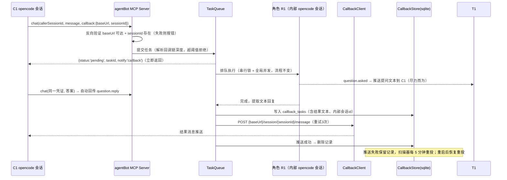

# 设计文档：Agent API 回调模式（chat 第三种结果获取方式）

## 背景

agentBot 以 MCP 对外提供 agent 能力（角色 R1 等）。调用方（其他 opencode 实例，简称 C1）
目前只有两种获取结果的方式：

1. 同步等待（`chat wait=true`，上限 20s，受 MCP 客户端 30s 工具超时约束）
2. 异步轮询（`chat` 返回 taskId，调用方反复 `get_result` 长轮询）

两者都要求调用方主动等待/轮询，长任务场景体验差且浪费调用。本设计新增第三种方式：

3. **回调模式**：调用方在 `chat` 时提供自身的 opencode 实例地址 + 当前会话 id，
   agentBot 立即返回受理响应；任务完成后由 agentBot 主动向调用方会话推送结果消息。

该机制同时打通了 agentBot 自身 opencode 实例上的角色 agent（它们挂载 agentBot 自己的
MCP，同样以回调方式被通知），从而形成角色间互相调用应答的多 agent 协作网络。

## 整体流程



## 回调目标获取（调用方自报）

参照 opencode-scheduler 的「被动发现 + 反向验证」：

- 调用方在 `chat` 参数中自报 `callback: { baseUrl, sessionId }`
  （调用方需自行获取自身 opencode server 地址与当前会话 id）
- agentBot 校验：`GET /session?limit=1`（可达性）+ `GET /session/{id}`（会话归属，404 拒绝）
- **校验失败直接报错**（明确优于静默降级）；未提供 callback 参数才降级为轮询模式

## 数据模型（sqlite：config/callback-tasks.db）

```sql
CREATE TABLE IF NOT EXISTS callback_tasks (
  task_id            TEXT PRIMARY KEY,  -- 关联 TaskQueue 任务
  role               TEXT NOT NULL,     -- 职能 key
  caller_base_url    TEXT NOT NULL,     -- 调用方 opencode 实例地址
  caller_session_id  TEXT NOT NULL,     -- 调用方会话 id（推送目标）
  internal_session_id TEXT NOT NULL,    -- agentBot 该角色内部 opencode 会话 id
  depth              INTEGER NOT NULL DEFAULT 1,  -- 回调链深度（循环防护）
  payload            TEXT NOT NULL,     -- 待推送的结果文本（重启恢复重投用）
  retries            INTEGER NOT NULL DEFAULT 0,
  created_at         INTEGER NOT NULL
);
```

- 仅终态（done/failed）推送写库；`waiting_input` 的提问推送为尽力而为（失败时任务会在
  10 分钟无应答后转 failed，终态推送仍会写库兜底）
- 推送成功即 DELETE；失败保留并递增 retries，扫描器持续重投
- WAL 模式；文件在 config 卷挂载内，Docker 重启后记录仍在

## 循环调用防护（深度阈值）

链路示例：C1 →（chat 回调）→ R1 →（R1 的 agent 调 agentBot MCP chat 回调）→ R2 → R3 …

- 深度自动递推：回调目标 sessionId 若命中 agentBot 内部会话（`internalSessionId` 反查），
  则新任务深度 = 父任务深度 + 1；外部会话（反查不到）深度 = 1
- 阈值 `session.maxCallbackDepth`（roles.json session 配置，默认 3，管理页可配）
- 超阈值直接拒绝（报错提示已达协作深度上限）

## 模块改动

| 模块 | 改动 |
|---|---|
| `src/api/callback-client.js`（新增） | opencode 回调执行器：`verifyTarget`（反向校验）、`pushWithRetry`（15s 超时，超时/中断视为服务端已入队，指数退避重试 3 次） |
| `src/api/callback-store.js`（新增） | sqlite 持久层：add/remove/listPending/bumpRetries，重启恢复 |
| `src/api/task-queue.js` | 任务携带 callback+depth；终态触发推送；waiting_input 推送提问；回调模式 `get_result` 不再长轮询；深度解析与阈值拒绝；扫描器重投 |
| `src/api/mcp-server.js` | `chat` 增加 callback 参数与反向校验；工具描述更新 |
| `src/agent/role-registry.js` | SESSION_DEFAULTS 增加 `maxCallbackDepth: 3` |
| `src/admin/admin-server.js` | 管理页增加「回调循环深度上限」配置项 |
| `src/constants.js` | LogPrefix.CALLBACK |

## 推送消息格式

- 完成：`[agentBot 回调] 角色「R1」任务 task_xxx 已完成：\n<reply>`
- 失败：`[agentBot 回调] 角色「R1」任务 task_xxx 已失败：<error>`
- 反问：`[agentBot 回调] 角色「R1」任务 task_xxx 等待补充输入（10 分钟内有效，请用原 callerSessionId 调用 chat 传回答复）：\n<questionText>`

## 边界与约束

- 回调模式任务的对象仍在 TaskQueue 内存中（终态保留 1h），`get_result` 可兜底查询
- 服务重启后内存任务丢失，但 sqlite 中未推送的终态记录带完整 payload，重投不丢结果
- 回调推送不阻塞任务调度（fire-and-forget），推送异常只影响记录清理，不影响任务状态
- 不需要新增 npm 依赖：`node:sqlite` 为 Node 22.13+ 内置（node:22-alpine 当前镜像已验证）
